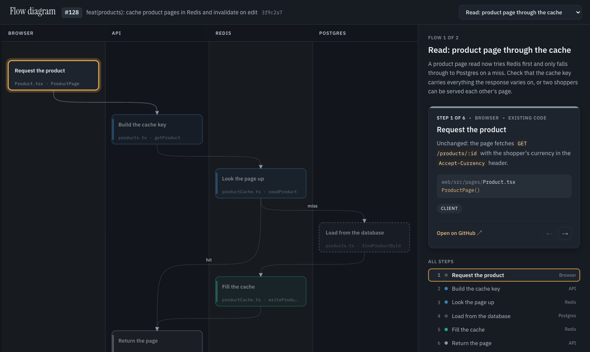

# pr-flow-diagram

An agent skill that turns a pull request into an interactive swim-lane diagram of its control flow. Reviewers walk the change in the order it runs, rather than reading files in alphabetical order.



[Open the live example](https://unclecheese.github.io/pr-flow-diagram/example/example.html)

## Install

```
npx skills add unclecheese/pr-flow-diagram
```

Add `-g` to install it for your user instead of the current project. Then ask your agent to "diagram PR 123", or to "add flow diagrams to the description of PR 123" for the Mermaid version.

## What you get

- One flow per entry point (a request, a job, a webhook), with a picker to switch between them
- Steps laid out in lanes by where the code runs, with branches labelled
- Steps the PR touches are solid and coloured by reviewer concern. Existing code and infrastructure are dashed
- A side panel per step with the file, function, line counts, a note and a link to the file at the PR's head
- Arrow keys to walk the flow, light and dark themes
- A Mermaid version for the PR description or a comment: one collapsible section per flow, with a review focus list linking to the files that need attention

## How it works

The agent reads the diff with `gh` and writes a small JSON flow document ([format](skills/pr-flow-diagram/references/flow-doc.md)). A dependency-free Node script validates it and renders one self-contained HTML file. Same JSON in, same bytes out.

## Requirements

- Node 20+
- GitHub CLI (`gh`), authenticated for the repo you're diagramming

## Development

```
npm test
```

The golden test compares `example/example.html` byte for byte. If you change the template or the build, regenerate it:

```
node skills/pr-flow-diagram/scripts/build.mjs example/example.flow.json example/example.html
```

## Licence

MIT
